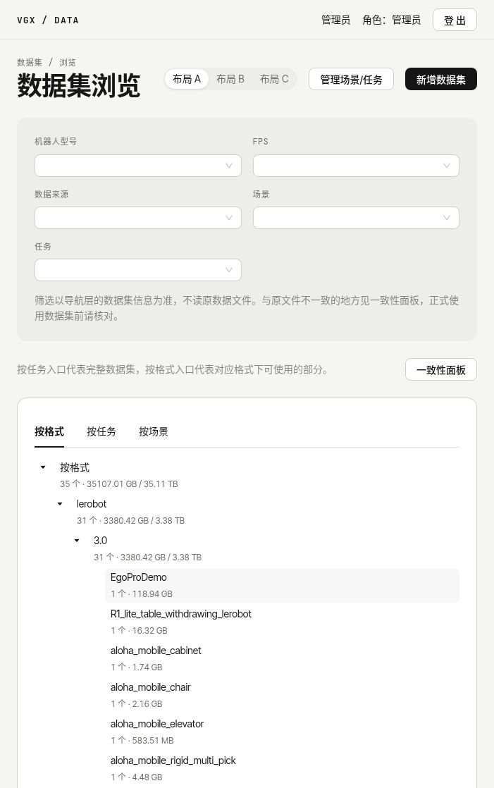
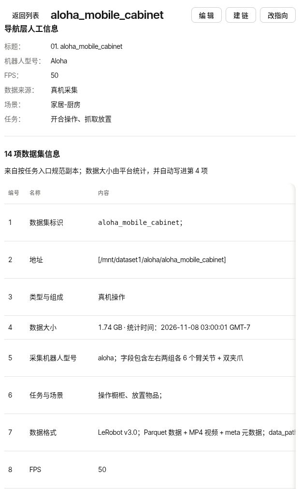
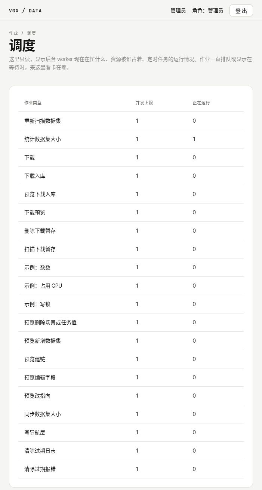
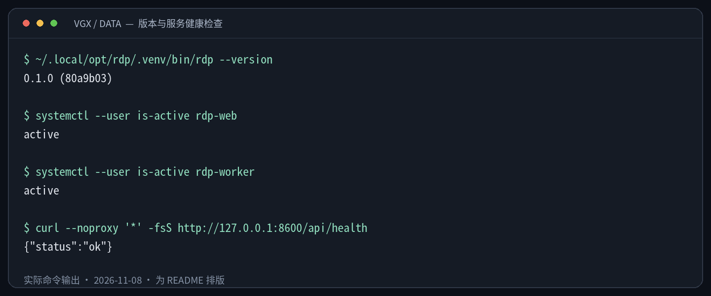
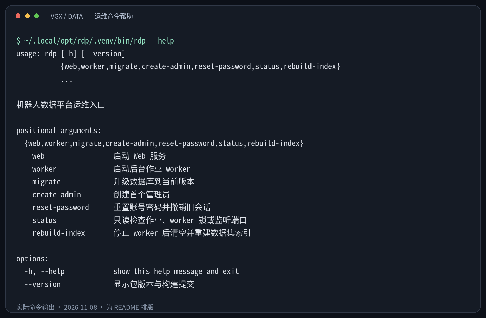

# VGX-DataCenter

机器人数据管理平台，面向工作站与 NAS 上的数据管理，通过 Web 界面逐步整合数据集浏览、开源数据下载、机器人登记、格式转换、实时预览和采集录制。

**当前阶段（2026-11-10）：M0 基础平台、M1 数据集管理、M1.5 第 01–19 张、M2 开源下载、M3 机器人与采集登记、M4 工具库与格式转换、M4.5 转换前数据清洗，以及 M5 的机器人连接检查和 R1 Lite 实时预览已合并至主分支。** MCAP 转换必须先做清洗预览，从报告选择保留或剔除的文件与 episode，再进行转换、检查和入库；转换与下载均支持空间估算参数。M5 支持平台公钥、网络/登录/就绪检查、自托管 Lichtblick，以及手动开启和停止预览，已有 R1 Lite 真机画面和按钮启停演练记录，但不代表 M5 整体验收完成。数据流检查第 4 层、AutoLife 接入、M6 采集录制仍待后续；本地备份与恢复尚未开工，M2 真实下载与入库仍待实测。

文档中的功能以主分支代码为准。2026-11-10 核对本机部署代码为 `3250fab`，包含 M4.5 和上述 M5 功能；此项核对不等同于重新执行运行验收。下方截图保留 2026-11-08 的 `80a9b03` 版本，尚未覆盖机器人、工具库、清洗转换、入库和实时预览页面。其他安装实例仍需自行升级，拉取或推送源码不会自动更新正在运行的服务。

第一次接触仓库，可先看 [Read First：目录与阅读指南](Read_First_What%27re_Files_Meaning%3F.md)，再按需要阅读安装说明或使用手册。

想先了解系统长什么样，可直接查看下面的[系统截图与终端示例](#系统截图与终端示例)。

项目采用 Python + React，原生运行于 Linux。Python 包、运维命令和服务名沿用 `rdp`。

## 系统截图与终端示例

> 采集于 2026-11-08，本机运行版本为 `0.1.0 (80a9b03)`。前端图片为实际页面的局部截图；终端图片由实际命令输出排版生成，并非终端窗口截屏。数据集数量、大小、时间和作业状态仅代表采集时刻，不是安装后的预置数据或性能承诺。

### 前端：从浏览数据集到查看运行状态

**数据集浏览**：按型号、FPS、来源、场景和任务筛选，通过按格式、按任务或按场景的目录定位数据集。



<details>
<summary>展开查看：数据集详情与后台作业调度</summary>

**数据集详情**：在同一页查看型号、FPS、来源、场景、任务及 14 项说明；图中展示部分信息项，数据大小由平台统计。编辑入口与查看内容相邻，截图过程未提交任何修改。



**作业调度**：查看各类作业的并发上限及正在运行的数量。需要了解作业排队原因时，再结合页面下方的 GPU 名额和导航层写锁信息排查。



</details>

### 终端：确认版本与服务是否可用

下图来自默认安装路径下的实际只读检查，没有执行安装、迁移、重启或重建索引。



可直接复制的命令：

```bash
# 查看部署版本，而不是当前源码目录的版本
~/.local/opt/rdp/.venv/bin/rdp --version

# 分别确认 Web 和 worker 服务处于运行状态
systemctl --user is-active rdp-web
systemctl --user is-active rdp-worker

# 本机健康检查绕过代理，避免 VPN/代理干扰 localhost 请求
curl --noproxy '*' -fsS http://127.0.0.1:8600/api/health
```

`active` 表示对应 systemd 服务正在运行；`{"status":"ok"}` 只说明 Web 可以响应，不代表 worker 作业或存储根都正常。worker 是否持续工作还应结合网页心跳、作业进度和日志判断。非默认安装需替换部署路径或监听地址；前台模式不适用上述 systemd 检查。

<details>
<summary>展开查看：运维命令帮助</summary>

帮助命令不执行其中列出的操作，可以先了解入口和参数，再按[运维手册](docs/manual/运维手册.md)操作。



```bash
~/.local/opt/rdp/.venv/bin/rdp --help
~/.local/opt/rdp/.venv/bin/rdp status --help
```

迁移数据库、重建索引和重置密码不是日常只读检查，请先阅读各自的操作前提，不要仅根据帮助截图直接执行。

</details>

## 更新（features、bugs）

- **[2026-11-10]** M5 第 01–04、08、09 张已合并：RobotProfile 正式配置、平台 SSH 公钥和三层连接检查、自托管 Lichtblick 1.30.0、机器人侧 `viz_relay`，以及网页“开启预览”“停止预览”按钮。默认显示 R1 Lite 头部左目、左右手腕三路画面和关节曲线；不提供机器人控制或采集录制。
- **[2026-11-10]** R1 Lite 已有真实画面、带宽/CPU 和平台按钮启停记录：开启时在普通用户目录 `~/rdp_viz/` 安装转发程序，停止后核对进程和端口释放。为兼容机器人没有 `ensurepip` 的环境，依赖以校验过的 wheel 解压安装，不创建 venv、不调用 pip、不使用 sudo。数据流检查第 4 层与 AutoLife 仍未完成。
- **[2026-11-10]** M4.5 转换前数据清洗合并并升级：数据集详情的“转换”改为“清洗预览”，只读检查 MCAP 的对齐切段（照搬 mcap2lerobot 的规则，真实样本与工具 verify 62 项一致）和段内数值、画面问题，生成报告；报告里按文件和 episode 选择保留或剔除，底部“进行转换”。有剔除时用 LeRobot 0.6.2 的 `delete_episodes` 删段，重新编码沿用工具的编码器和参数（R1 Lite 为 GPU 的 hevc_nvenc）。新增迁移 0022 和依赖 mcap、zstandard、lz4、Pillow。
- **[2026-11-10]** 修复：worker 作为 systemd 服务运行时没有 `TERM`，工具不画进度条，转换作业只显示阶段并记“连续30秒未解析出进度”。现在平台给工具开伪终端时固定设 `TERM=xterm-256color`。
- **[2026-11-09]** M4 第 07 张合并并升级：转换在新建暂存目录、执行工具前检查剩余空间，仅统计本次选中的数据块；转换表单与下载高级参数可填写百分比（0–1000 的整数）和偏置（0–1024 GiB），分别默认 25% + 1 GiB、100% + 1 GiB。下载仍在预览及开始执行时各检查一次。
- **[2026-11-09]** 作业详情只对成功或带警告成功的转换显示“检查并入库”；没有可写根时明确提示管理员登记 NAS 平台区。转换暂存页的失败条目仍可能显示入库按钮，后端会拒绝，见已知限制。Vitest 默认超时调整为 15 秒，以缓解高负载时长流程测试超时。
- **[2026-11-08]** M3 第 01–06 张完成：机器人登记、采集方式与用途词表、数据集采集信息和筛选、新建采集任务、人工登记转换关系。采集任务就是带采集信息的数据集，“计划中”可以先不带链接，不会在数据盘上创建目录。
- **[2026-11-08]** M4 第 01–06 张完成：工具登记、沙箱执行、逐帧进度、MCAP → LeRobot v3.0/v2.1、四层入库检查与血缘追溯；修复默认名追加作业编号后仍被误判占用的问题。第 05 张已记录真实输入、测试存储根上的全自动转换 → 检查 → 入库演练；浏览器页面演练与新截图仍待补充。
- **[2026-11-08]** 移除已完成上线迁移使命的“回填数据集信息”入口、接口及作业类型，FPS 和数据来源通过详情编辑维护；保留历史回填记录、既有数据库迁移及原文件比对提示。
- **[2026-11-08]** 操作日志、登录日志筛选支持只填日期，或输入不带秒、不带时区的时间；未写时区时按浏览器本地时间补全。网络与资源页的“立即检查”在 worker 返回新结果后显示检查结论和时间，不再一直停留在等待提示。
- **[2026-11-08]** 检查链增加 `make check-changed`：静态检查全跑，后端 testmon 和前端 Vitest related 只跑受影响的测试；交付前仍用 `make check` 全量检查。测试规范聚焦关键行为、避免跨层重复测试，先红后绿用于修缺陷，新功能通过评审中的变异抽查验证测试有效性。
- **[2026-11-08]** README 增加真实前端截图、终端输出示例及可复制的只读运维命令。
- **[2026-11-07]** 完整统计后自动同步第 4 项“数据大小”：字节数相同不改文字和日期，不同或无法解析时更新；大小按 1000 进制显示，达到 1 TB 才同时显示 GB/TB。移除全部用户撤回入口，保留写入日志、变更记录和失败恢复。
- **[2026-11-06]** 型号、FPS、数据来源、场景、任务五个筛选统一读取 `数据集信息.json`，增加与原文件型号/FPS 的比对提示，并完成上线所需的一次性回填（回填功能已于 11 月 8 日移除）；`来源.json` 第 2 版只存血缘与采集任务关联。取消每 10 分钟自动排查，保留启动及写入后的刷新；增加“排查”说明和“管理场景/任务”。
- **[2026-11-06]** 场景支持多选，修复长子任务保存失败；上线 Studio 外观、本地打包字体和等宽数据展示，浅深色继续跟随系统。
- **[2026-11-05]** 14 项信息移到详情页顶部，通过“编辑”原地修改并统一预览、确认写入；机器人型号并入第 5 项，场景与任务并入第 6 项。新建数据集支持选填信息，第 4 项数据大小由平台按格式统计；子任务改为多行记事本。就地编辑不再显示数据块字段。
- **[2026-11-04]** 场景和任务支持直接输入自定义值，已有自定义值可复用；详情页移除数据块表、“观察到的指向”列及数据集信息、原始路径的原文按钮。
- **[2026-11-04]** 数据集操作提交后留在当前页，用右下角作业卡片显示进度；关闭卡片不取消作业，成功后刷新相关数据。当时的撤回入口已于 11 月 7 日移除。
- **[2026-11-03]** 统一使用“密码”措辞，首次登录或管理员重置密码后明确提示先改密码；密码规则在输入框旁提示。移除作业页的示例提交入口，补充调度页的 GPU、导航层写锁及定时作业说明。
- **[2026-11-02]** 优化数据集、作业、表单和管理页面的分组、间距与信息层次；增加跟随系统并实时切换的浅色/深色模式。
- **[2026-11-01]** M2 开源下载合并：支持下载预览、下载作业、网络与资源监控和下载后入库；前端样式更新。
- **[2026-10-30]** M1 数据集管理工单完成；M1.5 增加字段编辑、场景与任务分类、原文件查看、视频转码与 Parquet 预览。
- **[2026-10-29]** M0 基础平台完成：账号与登录、操作日志与登录日志、后台作业、GPU 与并发调度、存储根检查、运维命令及 systemd 用户服务；使用手册和运维手册定稿，M1 数据集板块开始开发。
- **[2026-10-28]** 完善安装和升级流程，加入问答式一键部署；修复服务停止收尾、状态目录并发初始化、systemd 路径处理等问题。

## 环境安装

### 运行环境

| 项目 | 要求或当前约定 |
|---|---|
| 操作系统 | Linux，glibc 发行版，x86_64 或 aarch64 |
| Python | 3.12，由 uv 管理 |
| 前端工具 | Node.js 22.23.2、pnpm 11.22.0 |
| Python 环境工具 | uv 0.13.5 |
| 基础命令 | Bash、git、curl、tar、sha256sum、findmnt、ip、flock 和常用 coreutils |
| 服务管理 | 默认使用 systemd 用户服务；前台试用可选 `--no-systemd` |
| GPU | 普通浏览可不使用；当前 mcap2lerobot 转换需配置可用 NVIDIA GPU / NVENC，没空卡时排队 |
| M4 转换额外条件 | 已登记的工具程序、bubblewrap（`/usr/bin/bwrap`）、ffmpeg / ffprobe，以及登记为可写且空间足够的存储根 |
| M4.5 剔除 episode | 配置 `[tools] lerobot_python` 指向已有的 LeRobot 0.6.2 环境（本机为 conda 环境 `lerobot`），平台只读、断网使用并核对源码指纹；剔除阶段用转换作业的同一张 GPU。不剔除时不需要 |
| M5 工作站 | OpenSSH 客户端（`ssh`、`ssh-keygen`、首次授权用 `ssh-copy-id`）；另行安装锁定的 Lichtblick 网页包和机器人用 Foxglove SDK wheel；浏览器在工作站本机通过 localhost 打开 |
| M5 机器人 | 当前验证对象为 R1 Lite：aarch64、Python 3.10、ROS 2 Humble，平台公钥已授权、Profile 就绪条件满足；工作站可访问机器人 SSH 与预览端口 8765 |

Node.js、uv 和 pnpm 的安装版本以 [`scripts/setup.sh`](scripts/setup.sh) 为准；Python 和前端依赖分别由 `uv.lock`、`src/web/pnpm-lock.yaml` 锁定。转换与实时预览的额外组件按对应工具登记和版本约定单独准备。

### 一键安装

从 GitHub 获取代码并开始安装：

```bash
git clone https://github.com/Wanggcong/VGX-DataCenter.git VGX-DataCenter
cd VGX-DataCenter
bash scripts/setup.sh
```

安装脚本会引导检查工具、生成配置、选择导航层和存储根、构建前后端、迁移数据库并创建首个管理员。缺少指定版本的 Node.js、uv 或 pnpm 时，会说明下载来源并征求确认。基础命令和 systemd 需要自行准备。

安装时需提供已准备好的导航层绝对路径。导航层的目录、软链接和 JSON 约定见[导航层手册](docs/manual/导航层手册.md)。安装脚本负责配置和部署；数据集扫描与浏览已在 M1 实现。

默认位置：

| 内容 | 位置 |
|---|---|
| 部署目录 | `~/.local/opt/rdp/` |
| 配置文件 | `~/.config/rdp/config.toml` |
| 数据库和运行状态 | `~/.local/share/rdp/` |
| Web 运行日志 | `~/.local/share/rdp/logs/web.log` |
| worker 运行日志 | `~/.local/share/rdp/logs/worker.log` |

部署目录是源码仓库的独立 Git worktree，安装后应保留源码仓库及其位置。开机自启和退出登录后继续运行需要启用 linger，安装脚本会检查并提示。

详细安装、配置与故障排查见[运维手册](docs/manual/运维手册.md)。

## 功能介绍

### 已实现：M0 基础平台

| 功能 | 内容 |
|---|---|
| 账号与登录 | 管理员、成员两种角色；账号管理、首次改密提示、会话失效和密码重置；密码长度为 10–128 个字符 |
| 操作与登录日志 | 管理员查询、筛选日志和设置保留期 |
| 后台作业 | 提交、排队、进度、日志、取消、重新提交和中断恢复机制 |
| 调度与资源 | 按作业类型限制并发、分配 GPU、导航层写锁及定时维护作业 |
| 存储根状态 | 登记存储根，检查挂载来源、在线状态及访问超时 |
| 诊断与报错 | 统一诊断、错误编号和完整报错查询 |
| 部署与运维 | 安装、升级、数据库迁移、版本展示、Web 与 worker 服务管理 |

作业从对应功能页发起，例如数据集重新检查、字段编辑、下载、转换和入库；作业页集中查看状态、进度、日志与结果。示例作业的后端类型仍用于测试和演练，网页不再提供示例提交入口。采集任务登记、M5 连接检查和 R1 Lite 实时预览已实现；采集录制仍属 M6，尚未实现。

### 页面与交互

- 数据集、作业、下载及管理页面采用 Studio 外观：中性配色、细线卡片、等宽数字与标签，本地打包字体；浅色和深色实时跟随访问设备的系统外观，无手动开关，也不按时钟切换。
- 首次登录或管理员重置密码后，页面明确提示先设置新密码；完成后恢复菜单并返回原目标页。首个管理员不要求首次改密。
- 数据集操作提交后保留当前页面，右下角作业卡片显示状态、进度及详情入口。关闭卡片只隐藏提示，刷新页面也会清除卡片；作业仍可在作业列表查看。
- 调度页只读展示并发、GPU 占用、导航层写锁及定时作业，帮助定位作业排队和等待原因。
- 操作日志与登录日志的时间筛选可输入 `2026-11-08` 或 `2026-11-08 09:30`；省略的时分秒补零，省略时区时按浏览器本地时间解释，已带时区的输入保留原时区。开始时间包含边界，结束时间不包含边界；查看完整一天可填当天日期到次日日期。

### 开发路线

| 阶段 | 范围 | 状态 |
|---|---|---|
| M0 | 基础平台 | 基础工单完成；本地备份与恢复尚未开工 |
| M1 | 数据集索引、浏览、筛选、一致性检查与导航层受控写入 | 已有工单完成 |
| M1.5 | 就地编辑、统一筛选、多场景、手动排查、分类值管理、大小同步和原文件预览 | 19 张工单完成并合并；一次性回填入口已移除 |
| M2 | 开源数据下载、入库与网络/资源监控 | 5 张工单完成并合并；真实下载入库待实测 |
| 界面优化 | 页面布局、样式检查、深色模式与 Studio 视觉重设计 | 8 张工单完成 |
| M3 | 机器人登记、采集方式/用途词表、采集信息、新建采集任务及人工转换关系 | 6 张工单完成并合并；真实机器人与数据集关联由负责人在页面维护 |
| M4 | 工具库、格式转换、空间预检、入库检查和血缘记录 | 7 张工单完成，含既有端到端演练；第 07 张新增逻辑待真实演练，LeRobot v3.0 → v2.1 再导出暂不做 |
| M4.5 | MCAP 转换前数据清洗：清洗预览报告、文件/episode 剔除、LeRobot 删段 | 7 张工单完成并合并；真实样本对照和副本环境端到端演练已做，真实转换等 NAS |
| M5 | 机器人连接与实时预览 | 第 01–04、08、09 张完成并合并；R1 Lite 真机和按钮启停已有演练，整体演练文档、数据流第 4 层与 AutoLife 接入待补 |
| M6 | 采集录制 | 规划中 |

已实现范围以各阶段工单、后续决定记录和手册为准；M5 的实施与剩余范围见 [M5 地图](.scratch/m5-live-preview/map.md)和[工单](.scratch/m5-live-preview/issues/)，原始草案与后续已批准工单冲突时以后者为准。M6 仍按[原始里程碑规划](docs/brief/0003-初步建议与开图草案.md)及[平台规划总览](.scratch/platform-v1/map.md)在开工时细化方案和验收。

#### M0：基础平台

**目标：平台能够部署、登录，并执行和管理后台作业。当前状态：01–11、13、14 号工单完成；12 号本地备份与恢复尚未开工。**

- 建立前后端骨架、统一检查链、接口类型同步、函数契约与测试流程。
- 提供配置与状态目录、SQLite 数据库与迁移、统一日志和诊断报错。
- 完成账号、会话、角色权限、操作日志和登录日志。
- 建立独立 worker、作业生命周期、进度日志、取消与恢复、并发限制、GPU 分配和定时调度。
- 完成存储根检查、假导航层测试样本、安装升级脚本、systemd 服务和使用/运维手册。
- **后续补充**：本地备份与恢复已有规划，但尚未开工；NAS 备份等待接入事实。已有的数据库迁移前自动备份不能替代完整备份方案。

详细范围见 [M0 阶段计划](.scratch/m0-foundation/spec.md)，实施总结见 [M0 复盘](.scratch/m0-foundation/retro.md)。

#### M1：数据集板块

**目标：通过网页浏览、检查和受控维护现有数据集。当前状态：已有工单完成。**

- 扫描导航层并建立可重建索引：worker 启动时全量扫描，写导航层后刷新相关数据集；其余时候手动“排查”或“重新检查”，不再每 10 分钟扫描。大小统计仍在每天本地时间 03:00、相关写入后或手动触发。
- 提供按任务、按格式浏览及按场景分组；型号、FPS、数据来源、场景、任务五个筛选全部来自规范副本 `数据集信息.json` 的顶层字段，不解析 14 项说明文字。
- 展示数据集信息、链接状态、统计大小和一致性检查结果；支持三种页面布局切换。详情页的原文查看入口及编辑方式已由 M1.5 更新。
- 提供索引重建、建链、新增数据集、本地盘之间改指向和数据来源标注。
- **交付顺序**：先交付扫描、索引、接口与浏览等只读能力，再交付受控写导航层的能力；NAS 相关写入和批量迁移等待相应规则及环境事实确定。

详细范围见 [M1 阶段计划](.scratch/m1-datasets/spec.md)，当前任务见 [M1 工单](.scratch/m1-datasets/issues/)。

#### M1.5：数据查看、编辑与分类

- **14 项就地编辑**：详情页顶部展示 14 项信息，点“编辑”后，标题、可编辑项和子任务记事本直接变成输入框；点“预览改动”、核对差异后由管理员确认写入。就地编辑只修改 `数据集信息.json`，不再提供独立编辑器和数据块字段分节，也不提供用户撤回。
- **统一筛选与原文件比对**：数据来源在第 3 项选择，型号在第 5 项填写，场景和任务在第 6 项多选，正整数 FPS 在第 8 项填写。结构化值用于筛选，与说明文字分别保存。原始 `meta/info.json` 的型号/FPS 用于一致性比对，不决定筛选结果；差异只提示，不修改原始文件。一次性回填功能已移除，后续通过详情编辑维护这些字段。
- **场景和任务管理**：两者均可多选或直接输入自定义值，多场景数据集在各场景分组下出现。“管理场景/任务”可预览并从所有使用它的数据集中移除某个值；内置词表项不会隐藏，自定义值无人使用后从候选中消失。
- **新建时填写信息**：“新增数据集”表单提供可选的 14 项信息，第 4 项自动计算、不可填写，其余项可留空并以后补充；下载入库表单保持原流程。
- **自动统计与同步大小**：第 4 项显示平台统计值，未统计显示“未统计”，仍不可手填。完整统计后自动将大小、口径和日期同步到导航层第 4 项；字节数相同不写，离线或统计不完整时保留旧文字。LeRobot 只计 `data` 下的 Parquet、`videos` 下的 MP4 和 `meta` 文件，忽略隐藏目录；其他格式按全部大小统计。有数据块时不计块外文件，无数据块时按整个目标统计。页面按 1000 进制显示；第 4 项不到 1 TB 只写 GB，达到 1 TB 才写 GB/TB。详细口径见[使用手册](docs/manual/使用手册.md)。
- **子任务记事本**：以多行纯文本保存到 `数据集信息.json` 的 `subtask_notes`；已修复长文本保存失败，作业参数整体上限为 1 MiB，超过会明确提示。旧 `子任务.json` 原样保留，页面不再提供它的查看和编辑入口。记事本不参与搜索，不影响任务筛选。
- 只读浏览原文件，支持 JSON、文本、视频和 Parquet 预览；浏览器无法播放 AV1 时可转码预览。
- 数据盘上的原始文件仍只读；自动计算值及按路径推导的字段不直接编辑。
- **手动排查与写入安全**：一致性面板有“排查”按钮、上次排查时间及可折叠说明；排查本身只读。编辑、建链、改指向及重新检查后通过原页作业卡片查看进度。用户撤回已移除；写入失败或中断后的日志恢复与自动回滚仍在，历史变更记录继续保留。

详细范围和边界见 [M1.5 决定记录](.scratch/m1.5-edit-view-classify/decisions.md)及[工单](.scratch/m1.5-edit-view-classify/issues/)。

#### M2：开源下载与网络/资源监控

**目标：从下载前检查到下载后入库，形成可恢复、可观察的开源数据获取流程。当前状态：工单完成并合并，真实环境下载与入库待实测。**

- 经 hf-mirror 获取开源数据集及模型权重，下载前获取文件清单、固定版本并检查存储容量。
- 下载表单“高级参数”可设置空间估算百分比和偏置；按待下载量计算，默认 100% + 1 GiB。预览与开始下载时分别检查，可用空间不足则不开始下载；具体公式见下方[空间预检参数](#空间预检参数转换与下载)。
- 按现有需求使用 aria2 下载、curl 兜底，支持断点续传、重试、进度与取消，并核验下载文件。
- 展示代理/VPN 状态、网络速度和工作站资源占用，帮助判断下载路径与性能瓶颈。
- 在“网络与资源”页点“立即检查”请求镜像探测；worker 写回新结果后，页面显示“检查完成”、检查时间和镜像状态。“检查完成”不等于镜像一定可用，仍需看具体结论。
- 将下载接入 worker 作业体系，数据集产物按检查和入库规则登记到导航层。
- **已知限制**：镜像限流没有自适应降速；重定向检查存在时间窗；大型数据重新提交时可能重新计算已下载文件的哈希。真实下载和入库仍需在目标网络环境演练。详见 [M2 遗留事项](.scratch/m2-downloads/followups.md)。

调研依据见 [hf-mirror 下载机制](docs/research/hf-mirror下载机制.md)。

#### M3：机器人与采集任务登记

**目标：统一维护机器人身份和采集信息，并把采集任务纳入数据集管理。当前状态：第 01–06 张完成并合并。**

- “机器人”页维护名称、型号、序列号、多个网卡 MAC、地址、SSH 用户和端口；编号永久不复用，平台不保存机器人密码。型号沿用 `robot_model` 文本，不建独立型号表。
- “采集词表”维护采集方式和用途，采集方式关联数据来源。机器人和词表项可停用、恢复；有数据集引用时不能删除。场景和任务继续复用数据中心候选。
- **采集任务就是数据集**：在 `数据集信息.json` 顶层 `collection` 保存状态（计划中、采集中、已完成）、采集方式、用途和所用机器人；数据中心增加对应的四个筛选。登记对象存数据库，采集信息存导航层。
- “新建采集任务”复用 14 项信息；第 2 项填写计划存放地址。“计划中”允许不带第一条链接，之后有数据再建链，平台不替用户在数据盘创建目录。
- 数据集详情可人工登记转换来源，预览后由管理员确认，关系写入 `来源.json` 并在上下游两边显示。人工补录的关系可删除，worker 生成的关系不可删除；子任务记事本仍是文字记录。
- **范围边界**：登记采集信息不会启动录制；M5 已接入连接检查和 R1 Lite 实时预览，实际采集录制仍留到 M6。

现行约定见 [M3 决定记录](.scratch/m3-robots-collection/decisions.md)、[工单](.scratch/m3-robots-collection/issues/)和[使用手册](docs/manual/使用手册.md)第 10 节；早期领域方案以这些后续修订为准。

#### M4：工具库、格式转换与血缘

**目标：统一调用转换工具，让每份产物能够追溯输入、工具版本和配置。当前状态：第 01–07 张已完成并合并（截至 2026-11-09），见使用手册第 11 节、运维手册 8.3 及第 07 张工单。**

- 工具本体放在 `/mnt/datasets/工具/`，平台一点不改；平台仓库的 `tools/<工具名>/` 登记包写清单 `tool.toml` 和各型号的配置副本，以程序 sha256 锁定版本。网页"工具库"显示每个工具的状态（可用、程序找不到、指纹不符、清单无效）。
- 转换作业在 bwrap 沙箱里运行工具：整个文件系统只读（读数据盘不写访问时间），只有本作业的暂存目录可写，不联网；需要 GPU 的占一张卡。M4 时是五个阶段；M4.5 起为六个阶段：核对工具、核对输入（工具的 verify）、扫描、转换、剔除、收尾。
- 第 2 阶段先检查所选存储根在线情况，再按本次选中的数据块大小预检空间；默认估算为输入的 25% 加 1 GiB，可在清洗报告底部的“进行转换”区域调整。不足时以 `conversion.insufficient_space` 失败，不新建暂存目录，也不调用工具的 verify 或 convert。
- 工具不能改，平台给它的 stderr 开伪终端，从它自己的进度条里取出每个相机、state、action 的逐帧进度，作业详情逐项显示。
- 当前登记的 mcap2lerobot 适用于 Galaxea R1 Lite，输入 MCAP，可直接输出 LeRobot v3.0（默认）或 v2.1。这不同于把已有 LeRobot v3.0 数据再导出为 v2.1，后者尚未实现。
- 产物先进可写根的 `暂存/转换/<作业编号>/out/`，按结构、计数、视频、内容四层检查。无警告且默认名字、位置可用时自动入库；基础默认名被占用会先追加作业编号，再按最终名字判断。有警告或最终名字/位置仍冲突时等人确认，不通过则留在暂存区。
- 转换产物登记为新数据集，沿用输入的数据来源、型号、场景和任务，FPS 取产物元数据；不复制输入的 `collection` 采集信息，改用血缘连接原始数据集。入库后自动统计大小。
- `来源.json` 记录输入数据块、工具名和程序指纹、完整配置、命令参数、转换作业和检查结果；详情页显示上下游。
- 暂不做：RobotProfile 核对（先用工具自带的 verify）、v3.0 → v2.1 导出工具。

- **已验证范围**：第 05 张工单记录了真实 MCAP 输入、隔离测试导航层与测试可写根上的全自动转换 → 检查 → 入库演练，核对了上下游关系及数据盘写入计数；这不替代 M2 下载验收或浏览器页面演练。
- **已知限制**：转换仍固定使用第一个可写根；空间预检只反映执行时的容量，不预留或锁定空间，也不保证估算等于实际产物大小，运行中仍可能写满。失败转换在作业详情已隐藏入库按钮，但转换暂存页仍可能显示，点击会被后端拒绝，不会入库。Vitest 超时已调为 15 秒，历史后端偶发失败不因此视为已修复。其他待办见 [M4 遗留事项](.scratch/m4-tools-conversion/followups.md)。

实现与操作见 [M4 决定记录](.scratch/m4-tools-conversion/decisions.md)、[工单](.scratch/m4-tools-conversion/issues/)、[使用手册](docs/manual/使用手册.md)第 11 节和[运维手册](docs/manual/运维手册.md)第 8.3 节；设计依据见 [工具清单与转换血缘](docs/adr/0008-血缘写在导航层且转换产物经暂存区检查入库.md)。

#### M4.5：转换前数据清洗

**目标：转换前先看清数据质量，只把清洗后的数据转成 LeRobot。当前状态：第 01–07 张已完成并合并（2026-11-10），见使用手册第 11.2 节、运维手册和 [M4.5 工单](.scratch/m4.5-cleaning/issues/)。**

- **清洗预览**：数据集详情点“清洗预览”，选工具、型号和数据块，后台只读完整扫描所选 MCAP 文件，不是扫描整块磁盘；不占 GPU、不需要可写根。对齐切段照搬 mcap2lerobot 的规则（按 header.stamp 取最近、超容差为坏帧、坏帧和基准断点处切开、短于 90 帧丢弃），用平台登记包里同一份配置，所以报告里的 episode 就是工具会产出的 episode。
- **报告**：每个文件的对齐统计、坏帧、断点和致命问题；每个 episode 的数值检查（NaN/Inf、整段静止默认剔除；长时间静止、动作跳变、相机冻结、黑屏/过曝只提示）。H.264 话题的画面不检查。有致命问题的文件固定剔除，其余文件和 episode 都能手动改保留/剔除。
- **进行转换**：只能从报告发起，旧的直接转换入口已取消。转换前核对输入文件、工具、配置和清洗规则自预览以来没变，变了要重新预览；被剔除的文件不交给工具。工具转完先核对产物和报告一致，再用 LeRobot 删掉被剔除的 episode，然后照 M4 的流程检查、入库。血缘和 `转换回执.json` 记录预览编号、规则指纹、剔除的 episode 和原因、LeRobot 版本和指纹、重新编码的编码器参数。
- **已知限制**：只做 MCAP，已经是 LeRobot 的数据不清洗；只能整段剔除，不做逐帧裁切；剔除时被改动的视频是二次编码（样本 PSNR 约 51–54 dB），不与工具原产物逐字节相同；切段容差保持工具作者的设定，单帧超差也会切段。其他见 [M4.5 遗留事项](.scratch/m4.5-cleaning/followups.md)。

#### M5：机器人连接与实时预览

**目标：从网页检查机器人连接，并查看相机画面及关节观测/目标曲线。当前状态：第 01–04、08、09 张完成并合并，R1 Lite 已有真机及平台按钮启停演练；M5 整体验收尚未完成。**

- **RobotProfile**：按型号维护 `profiles/` 下的 TOML，描述关节来源、顺序、单位、相机编码、ROS 加入方式与就绪条件。已登记 R1 Lite 和 AutoLife 的事实配置；有配置不等于该型号已接入，AutoLife 尚待现场补测。
- **检查连接**：在机器人页提交后台作业，逐层检查网络、平台公钥登录和 Profile 就绪条件；前层失败即停止，没有 Profile 时跳过就绪检查并提示警告。平台不保存机器人密码，私钥只在状态目录，网页只显示公钥；第一次授权由负责人手动完成，不自动添加公钥。第 4 层“数据流频率对照”尚未实现。
- **实时查看**：工作站自托管 Lichtblick 1.30.0，按 Profile 生成布局；默认 R1 Lite 头部左目、左右手腕三路画面及关节观测/目标曲线，头部右目不进默认布局。预览按 `window.isSecureContext` 限制来源，本阶段只支持工作站本机通过 `http://localhost:8600` 使用，不提供远程 HTTP 预览或 HTTPS 部署方案。
- **手动启停**：“开启预览”通过 SSH 检查并上传、安装转发程序到机器人普通用户目录 `~/rdp_viz/`，随后启动；“停止预览”先断开页面查看器，再停止对应进程。打开页面不会自动启动；离开页面不等于停止程序，正式采集前必须手动停止预览。运行中的旧包不会热更新，需停止后重新开启。
- **只读转发**：`viz_relay` 只订阅和转发，不向 ROS 发布消息、调服务或改参数；不使用 sudo、不改厂商配置和原 DDS XML。只有有人订阅某通道才读取它；头部 H.264 只换封装并修正查看器兼容标志、不重编码，腕部 JPEG 当前原样转发、未降采样，关节转发上限为 50 Hz。
- **已验证与限制**：已有离线画面/曲线验证、R1 Lite 真机画面以及网页开启/停止的记录。真机样本默认三路加关节约 111.6 Mbit/s，转发进程约占单核 CPU 的 60%，仅代表该次测量，Wi-Fi 带宽不足仍可能卡顿。预览使用机器人 8765 端口，应仅在可信网络开放；DHCP 地址变化需手动更新登记，尚不按 MAC 自动查找地址。第 06 张整体演练与文档、第 07 张 AutoLife 接入仍待补齐，录制属于 M6。

实现与证据见 [M5 地图](.scratch/m5-live-preview/map.md)、[第 03 张转发程序](.scratch/m5-live-preview/issues/03-viz-relay.md)和[第 09 张平台启停](.scratch/m5-live-preview/issues/09-preview-start-stop.md)；共用事实约定见 [RobotProfile](docs/adr/0007-RobotProfile按型号共用且只写事实.md)，组件与兼容问题见 [M5 预览组件选型](docs/research/M5-预览组件选型.md)。

#### M6：采集录制

**目标：为不同机器人和采集工具提供一致的录制操作与结果管理。当前状态：规划中，录制状态机和会话模型尚待细化。**

- 接入原厂录制功能和自研采集工具，通过适配器衔接不同的命令、信号或管道协议。
- 规划启动、保存、丢弃、停止等统一录制操作，网页按钮与键盘操作使用同一组动作。
- 共用 RobotProfile，明确录制配置、时间语义及与预览、转换之间的衔接。
- 明确录制会话、采集任务、episode 和产出数据集的关系，细化产物登记、失败与中断的处理规则。
- **待细化**：录制状态机、异常场景和验收原型；UMI、ego 采集及仿真数据接入的具体流程尚未确定。

需求依据见[初始需求](docs/brief/0001-初始需求.md)，当前边界见[平台规划总览](.scratch/platform-v1/map.md)。模型训练与数据标注不在当前平台范围内。

### 数据与运行约定

数据管理遵循以下约定：

- **导航层保存数据集事实**：目录、软链接和 JSON 是数据集信息的依据；数据库中的数据集索引可通过重新扫描重建。
- **真实数据与导航层分离**：已有数据只读；平台写入由 worker 执行，仅限登记为可写的存储根，并且只新建产物。
- **Web 与 worker 分工**：Web 处理请求并提交作业，耗时任务由独立 worker 执行，通过 SQLite 保存的作业记录协调。
- **信息与血缘分开**：原有五个筛选字段及 M3 的 `collection` 采集信息保存在 `数据集信息.json` 顶层；`来源.json` 保存数据集身份和血缘。采集任务已经是数据集本身，不再使用独立的 `collection_task_id` 关联。一次性回填已完成并移除，后续通过详情编辑维护；历史记录与旧来源文件的读取兼容保留。
- **登记信息也要备份**：机器人、采集方式和用途存数据库，不在导航层；重建数据集索引不会重建这些登记表。导航层副本不能替代数据库和状态目录备份，具体操作见运维手册。
- **写入可追溯**：人工修改先预览再确认；平台自动的大小同步无需人工确认，但同样经过写锁、写入日志和变更记录。成功的修改不再有一键撤回，改错需重新编辑或改指向；失败恢复不受影响。

当前使用 HTTP，默认监听 `0.0.0.0:8600`；请部署在可信网络中。仅本机使用时，可在安装问答中选择 `127.0.0.1`。相关限制见[运维手册](docs/manual/运维手册.md)。

## 代码运行方式

### 已安装的服务

默认安装会启动 Web 和 worker 两个 systemd 用户服务：

```bash
systemctl --user status rdp-web rdp-worker
curl http://127.0.0.1:8600/api/health
```

Web 健康接口正常时返回 `{"status":"ok"}`，只表示 Web 可以响应；worker 状态另见服务状态和网页心跳提示。使用安装时创建的管理员账号登录安装脚本打印的访问地址。

```bash
# 停止服务
systemctl --user stop rdp-web rdp-worker

# 启动服务
systemctl --user start rdp-worker rdp-web
```

### 前台运行

首次安装时，可以选择前台模式：

```bash
bash scripts/setup.sh --no-systemd
```

脚本会在前台运行并监管 Web、worker，需保持终端打开；按 Ctrl+C 后停止两个进程。

对于已经安装、且确认两个服务均已停止的部署，也可以在两个终端分别运行：

```bash
# 终端一：Web
~/.local/opt/rdp/.venv/bin/rdp web

# 终端二：worker
~/.local/opt/rdp/.venv/bin/rdp worker
```

采用非默认配置时，两个终端都应设置相同的 `RDP_CONFIG`，指向对应配置文件。

### 升级

在源码仓库的 `main` 分支更新代码后执行：

```bash
git pull --ff-only
bash scripts/upgrade.sh
```

升级脚本默认部署本地 `main`，也可用 `--commit <提交或Tag>` 指定版本。源码更新不会自动改变正在运行的部署。升级前需处理完运行中或正在取消的作业；升级失败时保留现场和数据库迁移备份，按脚本输出及运维手册排查。

## 使用示例

### 浏览数据集并查看作业

1. 使用管理员账号登录，在“账号管理”中创建成员账号。
2. 成员首次登录后按提示修改密码，再进入“数据集”，按任务或格式选择一个数据集。
3. 在数据集详情发起“重新检查”，页面保持原位置，右下角出现作业卡片。
4. 从卡片观察状态和进度，或点“查看详情”查看日志与最终结果；检查成功后相关数据自动刷新。
5. 点卡片右上角关闭按钮隐藏提示。关闭不会取消作业；以后可在“作业”页继续查找记录。

### 编辑数据集信息

1. 在数据集详情点页头“编辑”，在原位置修改标题、14 项说明或子任务记事本。
2. 第 3 项选择数据来源，第 5 项填写型号，第 6 项选择或输入多个场景和任务，第 8 项填写正整数 FPS；第 4 项大小只读。
3. 点“预览改动”，核对差异后由管理员“确认写入”，在当前页面通过作业卡片观察执行结果。
4. 成功后自动回到查看模式并刷新字段；改错需重新编辑、预览和确认。“取消”只丢弃未提交草稿，不取消已经确认的后台作业。

这些操作修改导航层信息，数据盘上的原始 JSON、视频和数据文件保持只读。

### 新建数据集并填写信息

1. 在数据集页点“新增数据集”，填写数据集名、数据来源和第一条链接，按需选择格式入口。
2. 在“14 项数据集信息（可选）”中填写需要记录的信息；除了自动计算的第 4 项，其余项可选填，之后也可在详情页补充。
3. 生成预览、核对差异后确认写入，再通过作业卡片或作业详情查看结果。

### 登记机器人并规划一次采集

1. 在“机器人”登记设备，在“采集词表”确认采集方式与用途；这些操作不会连接机器人。
2. 数据中心点“新建采集任务”，填写名称、第 2 项计划地址、采集方式、用途和机器人；尚无数据时保留“计划中”，可以不填第一条链接。
3. 预览后由管理员确认写入。实际采集与录制仍由现有工具完成，平台暂不代为录制。
4. 数据准备好后，在原数据集“建链”并更新采集状态。需要补记已有转换产物的关系时，在产物详情“登记转换来源”，预览后确认。

### 检查机器人连接并开启实时预览

**先准备工作站侧的离线组件**：使用本次部署代码锁定的 Lichtblick 1.30.0 `lichtblick-web.tar.gz` 和 Foxglove SDK 0.30.3 aarch64 wheel。下面两条命令读取本地包、核对摘要后写入平台状态目录，不下载软件，也不会连接机器人；路径需换成已取得的真实文件路径。

```bash
~/.local/opt/rdp/.venv/bin/rdp install-lichtblick /本地路径/lichtblick-web.tar.gz
~/.local/opt/rdp/.venv/bin/rdp install-viz-relay-wheel /本地路径/foxglove_sdk-0.30.3-cp310-abi3-manylinux_2_28_aarch64.whl
```

版本与摘要分别锁定在 `src/rdp/infra/lichtblick.py`、`src/rdp/infra/viz_relay.py`，不能随意用其他版本替换；非默认配置需使用与 Web、worker 一致的 `RDP_CONFIG`。普通平台安装或源码推送不会自动完成这两项准备。

1. 在“机器人”核对型号、地址、SSH 用户和端口。首次点“检查连接”时 worker 会生成平台密钥；若登录未授权，在“平台公钥”弹窗复制命令，由负责人在工作站终端手动执行，**不要把密码或私钥写入仓库**。
2. 再点“检查连接”，在作业详情确认网络、登录、就绪检查结果；遇到就绪警告先按诊断核对，不把“SSH 能登录”等同于相机和关节数据都正常。
3. 在工作站本机用 `http://localhost:8600` 登录，打开该机器人的“实时预览”，手动点“开启预览”。此操作会在机器人 `~/rdp_viz/` 安装必要文件并启动程序，操作前应确认机器人可供预览。
4. 开启成功后页面连接机器人并显示查看器；若程序已经在运行，可点“连接”只重连查看器。默认看三路相机及关节曲线；型号未知的单位以页面提示为准。
5. 使用结束或正式采集前点“停止预览”，等待停止作业成功。关闭标签页不会代替停止操作；失败时查看作业诊断，不要直接终止其他机器人进程。

本阶段不支持控制机器人或开始录制；连接检查第 4 层尚未实现，画面和曲线是否有数据仍需在查看器中确认。

### 将 MCAP 转换为 LeRobot 并入库

1. 在“工具库”确认工具为“可用”，并确认 GPU、bwrap、ffmpeg / ffprobe 及已登记的可写存储根就绪；未登记可写根时需由管理员配置 NAS 平台区。
2. 打开有 MCAP 数据块、型号匹配工具的数据集，点“清洗预览”，选择工具、型号配置及数据块，等预览作业完成后点“查看清洗报告”。
3. 在报告里查看对齐和质量问题，按需改每个文件、每个 episode 的保留/剔除；在报告底部选输出版本，核对空间估算百分比与偏置（默认 25%、1 GiB），点“进行转换”，确认后查看转换作业详情。worker 预检空间不足时，工具尚未运行，也不会产生本次暂存目录。有剔除时需要已配置 LeRobot 环境。
4. 转换成功后系统自动提交四层检查；通过且默认名字、位置可用时自动入库。有警告或冲突时，在“转换暂存”检查并预览，由管理员确认；不通过时按诊断处理，不会入库。
5. 在新数据集的“转换关系”查看上游，核对自动生成的信息及大小；原始输入数据保持不变。

### 空间预检参数（转换与下载）

转换在清洗报告底部的“进行转换”区域提供“百分比（%）”“偏置（GiB）”；下载表单在“高级参数”中提供同样两项。

| 场景 | 目标大小 | 默认百分比 | 默认偏置 | 检查时机 |
|---|---|---|---|---|
| 转换 | 本次选中数据块的表观字节总和，不是整个数据集 | 25% | 1 GiB | worker 核对输入时，创建暂存目录及调用工具之前 |
| 下载 | 待下载字节量，扣除已完成的部分 | 100% | 1 GiB | 下载预览和开始下载时各一次 |

计算规则（`ceil` 表示向上取整到整字节）：

```text
所需字节 = ceil(目标字节 × 百分比 / 100) + ceil(偏置 GiB × 1024³)
可用字节 < 所需字节：检查失败，不开始转换或下载
```

百分比允许 **0–1000 的整数**，偏置允许 **0–1024 GiB**（可填小数）；旧作业未保存这两个参数时采用对应默认值。这里的 GiB 是 1024³ 字节，与数据集页面的十进制 GB 不同。例如选中输入为 100 GiB，默认转换门槛为 26 GiB。

参数只是容量估算，不会改变转换质量或下载内容，也不会实际锁定预留空间。不要为了通过预检随意降低数值；估计偏小或其他作业同时占用空间，仍可能导致执行途中失败。空间不足时诊断列出相关容量和参数；转换为 `conversion.insufficient_space`，下载为 `download.insufficient_space`，应先释放空间或按实际需求重新选择参数再提交。

### 查看存储与诊断

- 在一致性面板点“排查”检查全部数据集，或在详情点“重新检查”检查单个数据集；原文件型号/FPS 差异仅供核对，平台不会自动修复。
- 在“存储根”页面查看登记路径及在线状态，区分没挂载、挂错盘等原因。
- 在“调度”页面查看并发配置、GPU 分配和定时作业。
- 遇到报错时查看诊断中的对象、规则、实际与期望、后果和下一步；报问题时附上错误编号及页面底部的平台版本。

更多操作见[使用手册](docs/manual/使用手册.md)。

## 参考代码、文献

项目的设计依据、技术调研及来源集中保存在仓库中：

| 内容 | 入口 |
|---|---|
| 原始需求与约束 | [初始需求](docs/brief/0001-初始需求.md) |
| 技术栈与选择理由 | [ADR：技术栈](docs/adr/0002-技术栈.md) |
| Web 与前端路线 | [ADR：React 单页应用](docs/adr/0001-只做Web的React单页应用.md) |
| 作业执行与存储写入边界 | [ADR：独立 worker](docs/adr/0005-作业由独立worker执行且是导航层唯一写者.md) |
| 数据集事实与索引 | [ADR：导航层](docs/adr/0006-导航层是数据集的唯一事实来源.md) |
| 调研材料及其参考来源 | [调研目录](docs/research/) |
| 术语解释 | [术语表](GLOSSARY.md) |
| 接口文档 | 待补充 |
| 全部文档分类 | [文档地图](docs/README.md) |


## 开发与版本管理

- 负责人（王广聪）负责需求、验收和交付确认；开发人员负责代码实现、测试和日常维护。
- 现阶段开发人员可直接维护 `main` 分支，提交和合并代码无需负责人逐次审核。
- 较大功能或复杂修改使用 `feat/*`、`fix/*` 分支，完成后通过 PR 合并（目前可直接自己合并到 `main` 分支），说明修改内容和验证结果。
- 代码应做好必要注释，说明关键逻辑、接口参数及复杂算法。
- README 应说明项目功能、环境安装、代码运行方式和使用示例，并随代码更新。
- AI 生成代码及冲突解决结果需人工检查，提交前完成必要验证，保持 `main` 可运行。
- 重要架构或接口变更提前与负责人沟通，禁止随意强制推送或改写 `main` 历史。
- 数据集、模型权重、大型日志等大文件，以及包含密钥的配置文件，应将对应路径或匹配规则加入 `.gitignore`，避免提交至仓库。
- 重要版本打 Tag，记录运行环境、配置和模型版本。

### Contributors

| 贡献者 | 职责 |
|---|---|
| [王广聪（Wanggcong）](https://github.com/Wanggcong) | 需求、验收和交付确认 |
| [z1050297972-spec](https://github.com/z1050297972-spec) | 代码实现、测试和日常维护 |

### 开发检查

准备上述工具后，在源码仓库安装锁定的开发依赖：

```bash
uv sync --frozen
(cd src/web && pnpm install --frozen-lockfile)
```

开发过程中使用增量入口；`WEB_CHANGED` 是相对 `src/web` 的改动文件路径，多个路径以空格分隔：

```bash
# 只改后端时
make check-changed

# 改动前端时（按实际改动替换文件列表）
make check-changed WEB_CHANGED="src/time.ts src/audit/Pages.tsx"
```

此入口执行完整静态检查与 OpenAPI 过期检查；后端通过 pytest-testmon 选择受影响的测试，前端通过 Vitest related 选择相关测试。未指定前端改动文件时不跑前端测试；testmon 记录存于当前工作目录的 `.testmondata*`，首次没有记录时需要跑全量后端测试，记录文件不提交。

交付前统一运行一次全量检查到全绿，不在每次小改动后反复跑全量：

```bash
make check
```

`make check` 包括安装脚本语法、Python 格式与静态检查、类型与依赖边界、函数契约、Python 测试、OpenAPI 类型同步、前端类型与格式检查、CSS 样式检查及前端测试。

Git 提交钩子可通过以下命令启用：

```bash
git config core.hooksPath .githooks
```

钩子按暂存文件分流：纯规划文档提交跳过检查；仅改后端/测试 Python 文件及前端源码时运行 `make check-changed`；合并提交及脚本、配置、依赖等其他改动运行完整 `make check`。根目录 README 不属于纯规划跳过范围，其提交也会运行全量检查；可将这次钩子检查作为交付前的全量检查，不必重复运行。

测试只覆盖关键可观察行为，同一行为避免跨层重复测试，不以内部调用次数或日志原文作为实现契约。修缺陷时先用测试重现失败再修复；新功能不要求逐个测试先跑失败，由评审中的变异抽查验证测试能否抓住错误。具体规则以代码规范为准。

工程要求见[代码规范](docs/standards/CODING_STANDARDS.md)；AI 协作的文件归属、契约和评审规则见 [AGENTS.md](AGENTS.md)、[CLAUDE.md](CLAUDE.md) 与[协作流程](docs/agents/codex-workflow.md)。

### 项目结构

```text
src/rdp/          Python 后端：接口、账号、日志、作业、基础设施与运维入口
src/web/          React + TypeScript 前端
tests/            Python 测试及假导航层等测试样本；前端测试随前端源码存放
scripts/          契约检查、安装升级和 systemd 服务模板
tools/            平台侧工具登记包（清单、型号配置和清洗规则，不含工具程序或数据）
profiles/         按机器人型号维护的 RobotProfile 事实配置
src/rdp/robot_side/viz_relay/  部署到机器人侧的只读预览转发程序
envs/             外部工具环境的版本/指纹约定与 LeRobot 剔除适配入口
docs/             需求、架构决策、调研、手册、规范及协作说明
.scratch/         随版本管理的规划、阶段计划、工单及评审记录
GLOSSARY.md       统一术语
```

查看已实现范围可从 [M1 数据集计划](.scratch/m1-datasets/spec.md)、[M1.5 决定记录](.scratch/m1.5-edit-view-classify/decisions.md)、[M2 下载计划](.scratch/m2-downloads/spec.md)、[M3 决定记录](.scratch/m3-robots-collection/decisions.md)、[M4 决定记录](.scratch/m4-tools-conversion/decisions.md)、[M4.5 决定记录](.scratch/m4.5-cleaning/decisions.md)和 [M5 地图](.scratch/m5-live-preview/map.md)开始；具体任务和进度以对应工单的 `Status:` 为准。
